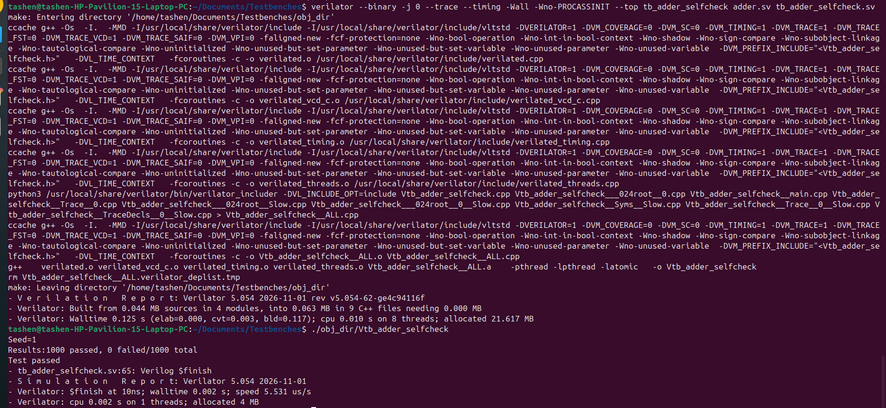

# Testbench-designs-

This project contains set of systemverilog challenges related to one linear random testbench architecture and three Selfchecking testbench. These testbenches are simulated by using open source IC design tools  such as Verilator and waveforms are generated via GTK Wave.

# Linear random testbench 

# Challenge 1

This is a Linear random testbench for the 8x8 synchronous memory with acknowledge handshake.

In this design tb_mem.sv will be the testbench and mem_dut.sv will be the dut file.
This testbench has modified it to use random addresses and data instead of the fixed values addr=4, wr_data=0xA5.The testbench has run 20 random write-then-read cycles. Each cycle selects a random 3-bit address (0–7) and a random 8-bit data value, writes them to the memory, reads them back from the same address, and verifies the read-back transactions. Here $urandom has utilized to generate both values and print the seed at the begining of the run.

State machine of the testbench follows the below stages as a single  transaction. 
IDLE-->WRITE_REQ-->WRITE_WAIT-->READ_REQ-->DONE

# Simulation steps

verilator --binary -j 0 --trace --timing -Wall -Wno-PROCASSINIT --top tb_mem mem_dut.sv tb_mem.sv

./obj_dir/Vtb_mem

# Simulation Results

# Selfchecking testbench 

# Challenge 2

Self-Checking a Combinational DUT

 In this design tb_adder_selfcheck.sv will be the testbench and adder.sv will be the dut file. This is a  4-bit adder. The checker is straightforward. This reference model computes a + b + cin in the testbench and compare against {cout, sum} from the DUT.

 $fatal is stronger than $error. $error records the failure and continues useful when developer want to count all failures across the full run. $fatal stops the simulation immediately  useful at the end.

 # Simulation steps

verilator --binary -j 0 --trace --timing -Wall -Wno-PROCASSINIT --top tb_adder_selfcheck adder.sv tb_adder_selfcheck.sv

.obj_sv/tb_adder_selfcheck

# Simulaton Results

# Selfchecking testbench 

# Challenge 3

Checking a Pipelined DUT

In this design tb_pipe_selfcheck.sv will be the testbench and adder_pipe.sv will be the dut file.
The adder mentioned in challenge 2 is combinational and  the output is valid one clock edge after the input. For a pipelined DUT, the output receives multiple cycles after the input, and several transactions can be in-flight paralllely. Hence simple inline comparison no longer applies because the expected output computed from the current input corresponds to a DUT output that has not appeared yet.

Hence the solution is a queue. Expected outputs are pushed in as inputs are applied, and popped out for comparison as DUT outputs appeared. This is the foundational pattern of a scoreboard.

The self-checking testbench for this DUT utilizes a tiny expected-output queue. On every cycle, a new expected value is pushed based on the current inputs. Two cycles later, when the DUT output arrives, the oldest expected value is popped and compared with the testbench output.

# Effect of the drain loop at the end of testbench

The drain loop at the end is necessary for pipelined DUTs. ONce the main stimulus loop finishes, the last two inputs are still travelling through the pipeline and their outputs have not yet arrived. Without the drain, those final results are never checked. Any bug that only manifests in the last few transactions will be silently missed.

# Effect of adding an Assertion

A helpful claim for a pipelined architecture is that, after reset is released, the DUT never drives X on its output. Even if the value calculated just so happens to be right, an X output indicates that an internal register was improperly initialized. This is a design flaw that could lead to misbehavior in downstream code.

 # Simulation steps

verilator --binary -j 0 --trace --timing -Wall -Wno-PROCASSINIT --top tb_pipe_selfcheck adder_pipe.sv tb_pipe_selfcheck.sv

.obj_sv/tb_pipe_selfcheck

# Simulaton Results

Verilator Simulation results are included in this file Part 2: Checking a Pipelined DUT Verilator.txt

GTKWave results

# Selfchecking testbench 

# Challenge 4